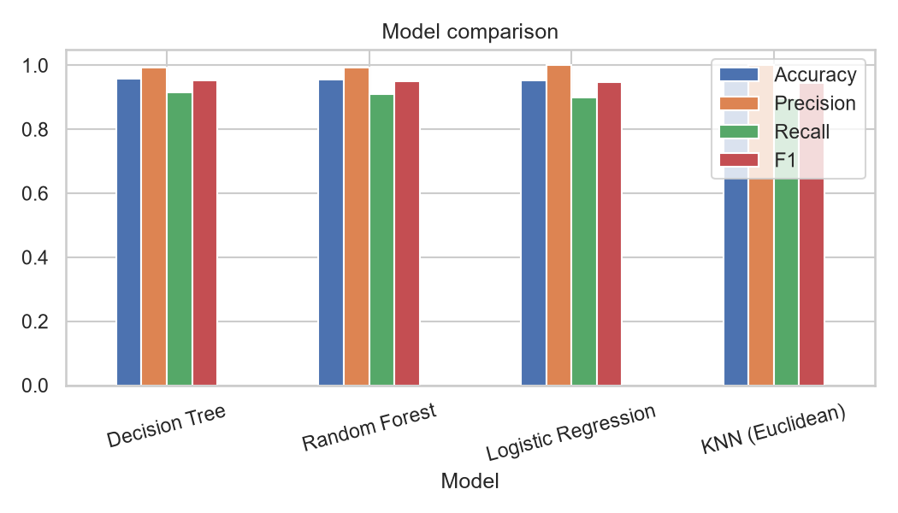
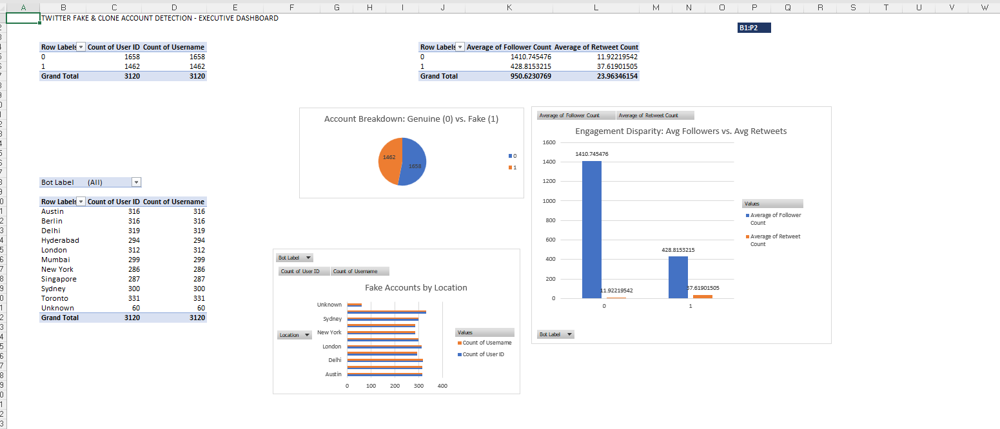

## 7. Results & Performance Summary

### Key Performance Indicators (KPIs)
* **Total Accounts Analysed:** 3,120
* **Fake / Bot Accounts Identified:** 1,462 (**46.86%** of total accounts)
* **Follower Disparity:** Fake accounts average **428.8 followers**, compared to **1,410.7 followers** for genuine accounts (over 3.2x fewer followers).
* **Retweet Amplification:** Fake accounts average **37.6 retweets**, compared to **11.9 retweets** for genuine accounts (over 3.1x higher amplification behavior).
* **Username Digit Pattern:** Fake accounts average **5.06 digits** in their usernames, whereas genuine accounts average only **0.41 digits**.
* **Verification Status:** Only **1.37%** of fake accounts hold verified status.

### Classification Model Comparison

| Model | Accuracy | Precision | Recall | F1-Score | ROC-AUC |
| :--- | :---: | :---: | :---: | :---: | :---: |
| **Decision Tree** | **95.77%** | 99.40% | **91.51%** | **95.29%** | 95.28% |
| **Random Forest** | 95.51% | 99.40% | 90.96% | 94.99% | 95.32% |
| **Logistic Regression** | 95.26% | **100.00%** | 89.86% | 94.66% | **96.29%** |
| **KNN (Euclidean)** | 95.13% | **100.00%** | 89.59% | 94.51% | 95.48% |

### Clone Account Detection (Euclidean Distance)
* Using nearest-neighbor Euclidean distance and username similarity scoring, the pipeline flagged **30 high-confidence suspected clone pairs** (such as `kgohgun` vs. `kgohgun_` with a Euclidean distance of **0.0022** and **93.3%** username similarity).

